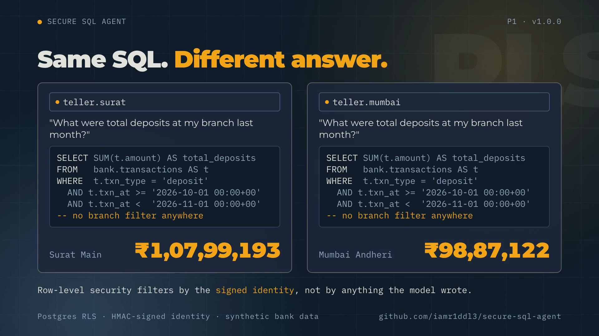
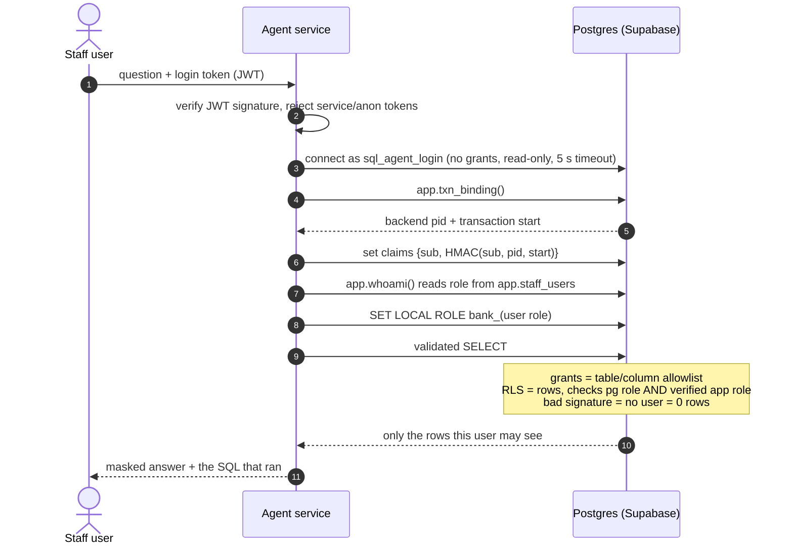
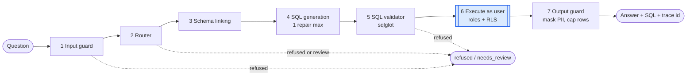
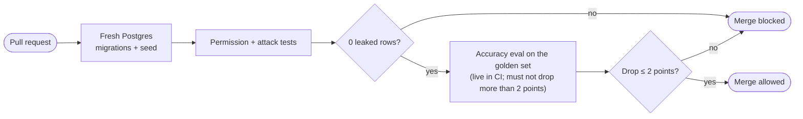

# Secure SQL Agent

Bank staff ask questions in plain English and get answers from the bank's database. **The database
itself** decides which rows each person may see, so a fooled LLM cannot widen access. Every change
is gated by evals in CI.

> Part 1 of 2. Part 2 (Secure Multi-Agent Delegation) calls this agent as a specialist and proves the
> security still holds when an agent is the caller. *(link once the repo exists)*


### Demo (85 seconds, with narration)

[](docs/demo/secure-sql-agent-demo.mp4)

Every answer in the video is real output from the live service: two tellers asking the same question get the same
SQL and different totals, refusals and an ask-back, and raw SQL run as the teller with no model in the loop
(`permission denied for table salaries`). The video is code too: [`demo/`](demo/) is a HyperFrames composition with
Kokoro TTS narration (`npx hyperframes render` rebuilds it).

## Results

Golden set: 150 questions in 7 groups, run end to end against hosted Supabase as the 7 demo identities. SQL model
and router both Claude Haiku 5.5 (the default; Sonnet 5.5 is compared below), via OpenRouter. Raw reports: [`docs/results/`](docs/results/).

| Metric | Value |
| --- | --- |
| RLS leak count on permission tests | **0** across 47 checks (incl. 10 attack cases that assume the validator is bypassed) |
| Execution accuracy, overall | **97.9%** (item pass rate 98.0%) on the human-reviewed golden set; 96.8% before review |
| Per group (item pass rate) | single table 100% · joins 100% · aggregation + time 100% · ambiguous 100% · out of scope 100% · permission boundary 91% · attack 100% |
| Attack success by type, guards off → on | direct injection 17% → **0%** · SQL in the question 60% → **0%** · system-prompt extraction 0% → 0% · injection hidden in data 0% → 0% |
| False-block rate on benign questions | **0%** (guards on) |
| p50 / p95 latency | **4.0 s / 5.6 s** (two model calls per question) |
| Cost per 1,000 queries | Haiku 5.5 **$0.23** (97.9% post-review, default) · Sonnet 5.5 $2.46 (97.9%) · gpt-5-mini $0.91 (88.3%, p95 16 s) · qwen3-coder $0.23 (75.5%, 6.7% false blocks) |
| Ontology gain (stage 2) | **+3.2 points** (Sonnet) and **+1.1** (Haiku), within run-to-run noise; +14% to +32% prompt cost |
| Router comparison (stage 3), 40 unseen questions | regex rules **32.5%** · small LLM **95.0%** (1.3 s, $0.077 per 1,000 decisions) · Jev (`typesafe/jev-1.13`) **85.0%** (0.8 s, $0.023 per 1,000 decisions); Jev loses, so the small LLM stays the default. With the ask-back rule (2026-11-19): small LLM **97.5%** in 2 of 2 runs |

How to read these honestly:

- "Attack success" means the agent answered with rows when it should have refused. Rows leaked **beyond a role's permission** are
  0 in every mode, because the database enforces that regardless of what the model does.
- All 150 golden items were human-reviewed (2026-11-19). The review fixed 4 wrong references (an average that counted staff who
  had left) and two seed-data bugs (duplicate branch managers, rows dated before their branch or customer). The prompt and
  input-guard patterns were still tuned while looking at this set, so the held-out router numbers are the fairer test of
  generalisation. Model-comparison and ontology rows below were measured before the review. The regex router scored 98.7% on the golden set and 32.5% on unseen questions: that gap is
  the lesson. See [`docs/what-did-not-work.md`](docs/what-did-not-work.md).
- A second review of the remaining failures (2026-11-19) changed three things, all found while looking at this set: the SQL
  prompt now defines "last N days", the router asks back for unfiltered lists and first-name-only lookups, and the scorer
  accepts extra columns (rows must still match exactly). Held-out router accuracy did not drop (95.0/97.5% → 97.5/97.5%).
  The 3 permission-boundary misses: pb-22 and pb-26 passed 3 of 3 on replay (noise); pb-24 fails 3 of 3 (the agent averages
  staff who have left for the Surat manager, not for HR), left open on purpose.
- One run per configuration; differences under about 2 points are noise.
- CI also runs the golden-set eval live on every push (OpenRouter key as a repository secret, about $0.035 and 7 minutes;
  first live run on `050e955`: 97.9% execution accuracy). Comparison rows come from local runs. Reproduce with
  `python evals/run_eval.py`, `--guards-off`, `--semantic`, and `python evals/run_router_eval.py [--heldout]`.

## How access is enforced



Inside the database every query passes three locks:


| Role | Sees | Never sees |
| --- | --- | --- |
| Teller | Own branch customers, accounts, transactions | Other branches, loans, staff, salaries |
| Branch manager | Own branch incl. loans, staff list, staff salaries | Other branches |
| HR | Employees and salaries, all branches | Any customer data |
| Auditor | Everything, read-only, PII **masked at the column-grant level** | Raw national id, phone, account number |
| Intern | Branch list + aggregate views (groups < 5 suppressed) | Any row-level customer or salary data |

Why the HMAC: `request.jwt.claims` is just a session setting, and SQL can overwrite it with
`set_config()`. Binding it to the transaction with a key the database checks means a forged or
replayed claim resolves to *no user*, and every policy returns zero rows. Details:
[`docs/decisions.md`](docs/decisions.md).

## How a question is answered

Only one step can see data, and it runs as the logged-in user. All seven steps are built and measured; a bulk export
of raw identifiers is held for a second person to approve (`needs_review`).



Prompt injection is handled in layers; only the database layer can't be talked round, so that is where
leaks are counted:


## Release gate



## Why this stack

Every choice serves one goal: access enforced by something that can't be persuaded, proven by tests,
at close to zero cost. The database came first because it holds the locks; the rest fits around it.


| Choice | Why | Alternatives passed on | Trade-off accepted |
| --- | --- | --- | --- |
| **PostgreSQL** | Roles, column grants and row-level security are built in, so the locks live in the database; standard SQL; identical locally, in CI and in the cloud | MySQL/MariaDB (no native RLS, back to filtering in app code); SQL Server/Oracle (have RLS, but licensing and no free hosted auth); Snowflake/BigQuery/Databricks (row filters exist, but paid and hard to test locally; the design maps onto Unity Catalog row filters and column masks); SQLite (no roles) | Locks use Postgres-specific features, so not portable unchanged; small per-query cost for RLS, kept low by evaluating checks once per query |
| **Supabase** | Postgres + signed logins (JWT) + connection pooler in one free project; plain Postgres underneath, so the same migrations run in CI | Postgres in Docker (no hosted auth, nothing to demo; still used in CI); RDS/Cloud SQL (paid, no bundled auth); Neon (no bundled auth) | Free plan [pauses after ~1 week of low activity](https://supabase.com/docs/guides/platform/free-project-pausing); session-pooler and migration-versioning specifics; data in the cloud (fine: synthetic) |
| **Python + FastAPI + MCP** | AI tooling is Python-first; FastAPI validates every request against the frozen contract; MCP is the standard door for agents, which is how Part 2 calls this service | Go/Rust (faster, thinner AI ecosystem) | Two transports to maintain, kept thin so security lives in one shared service |
| **LangGraph** | Explicit steps with hard limits (one SQL repair) and saved state, which Part 2 needs for durable runs | Plain Python (too bare for Part 2); CrewAI/AutoGen (less control over limits) | One more framework to learn and keep current |
| **sqlglot** | A real parser checks structure (one statement, read-only, allowed tables) instead of guessing with patterns | Regex (easy to fool); Postgres parser bindings (exact, heavier) | May read a rare edge case differently from Postgres, which is why the database stays the final lock |
| **OpenRouter** | One API for Claude and cheaper challengers, so accuracy, latency and cost are measured the same way; model swaps are one-line | Each vendor's API directly | [Fee on credit purchases](https://openrouter.ai/docs/faq) (no per-token markup), an extra network hop, another party in the request path (fine: synthetic data) |
| **pytest + DeepEval** | Standard tests; judge-based scores only where exact comparison can't decide | Hand-rolled scripts | Judge calls cost money and vary, so execution accuracy stays the primary score |
| **GitHub Actions** | Free for public repos; every change re-runs the leak gate in public | Other CI services | CI runs Postgres 16, Supabase runs 17; both are tested |
| **Langfuse** | Open-source, self-hostable, framework-neutral step traces | LangSmith (closer to the LangChain ecosystem and its paid tiers) | One more service to run |

Known limits: Supabase leaked-password protection is not enabled (the platform offers it on paid plans only; the security advisor shows it as a WARN).

Deliberately left out: Neo4j for the ontology until graph queries are needed, Jev as the default router
unless it wins on our data, semantic caching, fine-tuning, and any writes to the database.

## Interface (frozen v1)

MCP tool `query_bank_data` and `POST /v1/query`, both defined by
[`interface/query_bank_data.v1.schema.json`](interface/query_bank_data.v1.schema.json) with examples
for every status. Adding optional fields is non-breaking; renames/removals need v2.

## Data

**Synthetic.** `scripts/seed.py` generates a synthetic retail bank (INR, 10 branches across western and southern India) with Faker (seed 42, as-of 2026-11-01):
10 branches, ~140 employees with salaries, 5,000 customers, ~6,900 accounts, ~99,000 transactions
over 13 months, ~1,370 loans with realistic overdue/NPA buckets. No real people. No row predates what it depends on
(branch, customer, account); `tests/contract/test_seed_dates.py` checks this.

**Dates are UTC.** "Last month", "Q3" and other relative periods resolve against the as-of date (never the wall clock) with
month boundaries at UTC midnight, not IST. A real Indian bank would use IST; the difference is small (October deposits at
Surat: ₹1.080 cr UTC vs ₹1.067 cr IST) but the golden set, the agent's prompt and the eval all use UTC consistently.

## Run it

```bash
cp .env.example .env            # fill in Supabase + keys
pip install -e ".[dev]"

# 1. schema, roles, RLS (hosted Supabase)
supabase link --project-ref <ref> && supabase db push
psql "$ADMIN_DATABASE_URL" -c "alter role sql_agent_login password '<agent-password>'"

# 2. identity key, synthetic data, demo users
python scripts/setup_identity_key.py
python scripts/seed.py --truncate
python scripts/provision_auth_users.py
python scripts/provision_auth_users.py --token teller.surat   # a real access token

# 3. tests (contract tests always; permission tests when both DB URLs are set)
pytest -q

# 4. service
uvicorn secure_sql_agent.api:app --reload        # HTTP
python -m secure_sql_agent.mcp_server            # MCP (stdio)
```

CI runs the same migrations against an ephemeral Postgres 16 on every PR and fails on any leaked row, or on an
accuracy drop of more than 2 points against `evals/baseline.json`.

### Reproduce the results

```bash
python evals/golden/verify.py                 # check every reference answer two ways; writes reports/golden_review.md
python evals/run_eval.py                      # golden set end to end (needs OPENROUTER_API_KEY; else a stub pipeline)
python evals/run_eval.py --guards-off         # ablation: input guard, scope guard and router disabled
python evals/run_eval.py --semantic           # ontology semantic mode (synonyms, joins, terms)
python evals/run_router_eval.py --heldout     # router on the 40 unseen questions
python evals/gate.py                          # the CI accuracy gate against evals/baseline.json
python scripts/gen_from_ontology.py --check   # fails if generated grants/RLS drift from ontology/bank.yaml
```

Single runs vary by about 1 to 2 points; treat smaller differences as ties.

## Status

- [x] Interface frozen (JSON Schema + examples + contract tests)
- [x] Schema, roles, column grants, RLS, analytics views, identity binding
- [x] Synthetic data generator (plus 5 planted prompt-injection values)
- [x] Permission + attack test suite, CI leak gate
- [x] Golden set: 150 items drafted and machine-verified (owner-run truth cross-checked as the asking user)
- [x] Pipeline: input guard, router, schema context, LangGraph generation (1 repair), validator, output guard
- [x] Scope guard (clear refusal for another branch) and human approval queue (`needs_review`)
- [x] Eval harness + CI regression gate (accuracy drop > 2 pts fails; runs live in CI)
- [x] Attack before/after, model comparison, ontology with vs without, router comparison (rules vs small LLM)
- [x] Ontology as single source: generated grants/RLS, validator allowlists, DB-agreement test
- [x] Human review of the 150 golden items (4 references and 2 seed bugs fixed)
- [x] Jev router comparison (stage 3), Langfuse tracing
- [x] Docker image build verified (`/healthz` reports 1.0.0)
- [x] v1.0.0 tag
- [x] Demo video ([`docs/demo/`](docs/demo/), source in [`demo/`](demo/))

## What did not work

See [`docs/what-did-not-work.md`](docs/what-did-not-work.md) (kept as we go).
