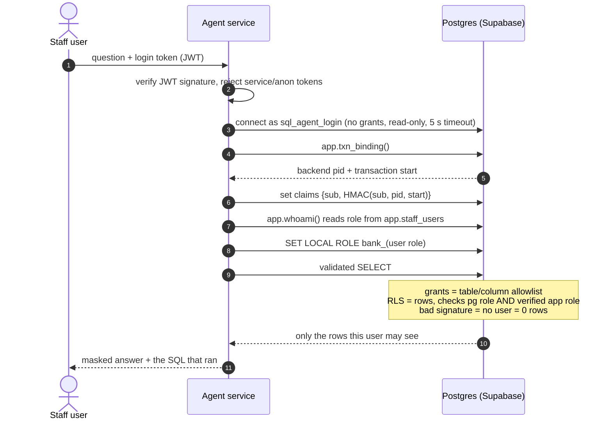
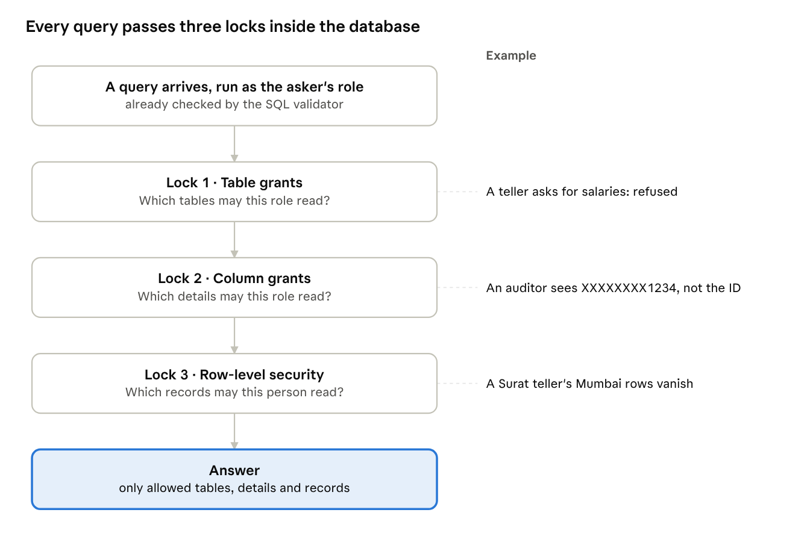
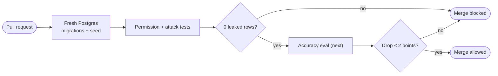
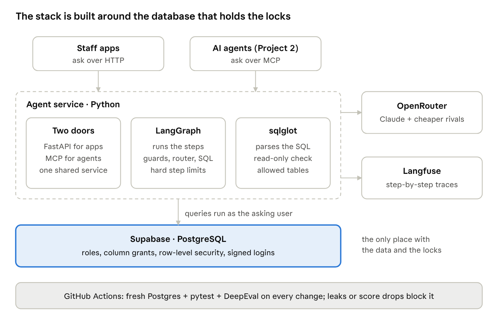

# Secure SQL Agent

Bank staff ask questions in plain English and get answers from the bank's database. **The database
itself** decides which rows each person may see, so a fooled LLM cannot widen access. Every change
is gated by evals in CI.

> Part 1 of 2. Part 2 (Secure Multi-Agent Delegation) calls this agent as a specialist and proves the
> security still holds when an agent is the caller. *(link once the repo exists)*


## Results

| Metric | Value |
| --- | --- |
| RLS leak count on permission tests | **0** across 47 checks (incl. 10 attack cases that assume the validator is bypassed) |
| Execution accuracy, overall / per group | not yet measured (stage 1) |
| Attack success rate by type, before → after guardrails | not yet measured |
| False-block rate on benign questions | not yet measured |
| p50 / p95 latency | not yet measured |
| Cost per 1,000 queries per model | not yet measured |
| Ontology gain (stage 2) | not yet measured |
| Router comparison (stage 3) | not yet measured |

Numbers are only ever filled in from `reports/` produced by CI.

## How access is enforced



Inside the database every query passes three locks:



| Role | Sees | Never sees |
| --- | --- | --- |
| Teller | Own branch customers, accounts, transactions | Other branches, loans, staff, salaries |
| Branch manager | Own branch incl. loans, staff list, staff salaries | Other branches |
| HR | Employees and salaries, all branches | Any customer data |
| Auditor | Everything, read-only, PII **masked at the column-grant level** | Raw national id, phone, account number |
| Intern | Branch list + aggregate views (groups < 5 suppressed) | Any row-level customer or salary data |

Why the HMAC: `request.jwt.claims` is just a session setting, and SQL can overwrite it with
`set_config()`. Binding it to the transaction with a key the database checks means a forged or
replayed claim resolves to *no user*, and every policy returns zero rows. Details:
[`docs/decisions.md`](docs/decisions.md).

## How a question is answered

Only one step can see data, and it runs as the logged-in user. Status: the database locks (step 6) are
built and tested; the other steps are being built next, each behind an eval.


Prompt injection is handled in layers; only the database layer can't be talked round, so that is where
leaks are counted:


## Release gate



## Why this stack

Every choice serves one goal: access enforced by something that can't be persuaded, proven by tests,
at close to zero cost. The database came first because it holds the locks; the rest fits around it.



| Choice | Why | Alternatives passed on | Trade-off accepted |
| --- | --- | --- | --- |
| **PostgreSQL** | Roles, column grants and row-level security are built in, so the locks live in the database; standard SQL; identical locally, in CI and in the cloud | MySQL/MariaDB (no native RLS, back to filtering in app code); SQL Server/Oracle (have RLS, but licensing and no free hosted auth); Snowflake/BigQuery/Databricks (row filters exist, but paid and hard to test locally; the design maps onto Unity Catalog row filters and column masks); SQLite (no roles) | Locks use Postgres-specific features, so not portable unchanged; small per-query cost for RLS, kept low by evaluating checks once per query |
| **Supabase** | Postgres + signed logins (JWT) + connection pooler in one free project; plain Postgres underneath, so the same migrations run in CI | Postgres in Docker (no hosted auth, nothing to demo; still used in CI); RDS/Cloud SQL (paid, no bundled auth); Neon (no bundled auth) | Free plan [pauses after ~1 week of low activity](https://supabase.com/docs/guides/platform/free-project-pausing); session-pooler and migration-versioning specifics; data in the cloud (fine: synthetic) |
| **Python + FastAPI + MCP** | AI tooling is Python-first; FastAPI validates every request against the frozen contract; MCP is the standard door for agents, which is how Part 2 calls this service | Go/Rust (faster, thinner AI ecosystem) | Two transports to maintain, kept thin so security lives in one shared service |
| **LangGraph** | Explicit steps with hard limits (one SQL repair) and saved state, which Part 2 needs for durable runs | Plain Python (too bare for Part 2); CrewAI/AutoGen (less control over limits) | One more framework to learn and keep current |
| **sqlglot** | A real parser checks structure (one statement, read-only, allowed tables) instead of guessing with patterns | Regex (easy to fool); Postgres parser bindings (exact, heavier) | May read a rare edge case differently from Postgres, which is why the database stays the final lock |
| **OpenRouter** | One API for Claude and cheaper challengers, so accuracy, latency and cost are measured the same way; model swaps are one-line | Each vendor's API directly | [Fee on credit purchases](https://openrouter.ai/docs/faq) (no per-token markup), an extra network hop, another party in the request path (fine: synthetic data) |
| **pytest + DeepEval** | Standard tests; judge-based scores only where exact comparison can't decide | Hand-rolled scripts | Judge calls cost money and vary, so execution accuracy stays the primary score |
| **GitHub Actions** | Free for public repos; every change re-runs the leak gate in public | Other CI services | CI runs Postgres 16, Supabase runs 17; both are tested |
| **Langfuse** | Open-source, self-hostable, framework-neutral step traces | LangSmith (closer to the LangChain ecosystem and its paid tiers) | One more service to run |

Deliberately left out: Neo4j for the ontology until graph queries are needed, Jev as the default router
unless it wins on our data, semantic caching, fine-tuning, and any writes to the database.

## Interface (frozen v1)

MCP tool `query_bank_data` and `POST /v1/query`, both defined by
[`interface/query_bank_data.v1.schema.json`](interface/query_bank_data.v1.schema.json) with examples
for every status. Adding optional fields is non-breaking; renames/removals need v2.

## Data

**Synthetic.** `scripts/seed.py` generates a synthetic retail bank (INR, 10 branches across western and southern India) with Faker (seed 42, as-of 2026-11-01):
10 branches, ~140 employees with salaries, 5,000 customers, ~6,900 accounts, ~99,000 transactions
over 13 months, ~1,370 loans with realistic overdue/NPA buckets. No real people.

## Run it

```bash
cp .env.example .env            # fill in Supabase + keys
pip install -e ".[dev]"

# 1. schema, roles, RLS (hosted Supabase)
supabase link --project-ref <ref> && supabase db push
psql "$ADMIN_DATABASE_URL" -c "alter role sql_agent_login password '<agent-password>'"

# 2. identity key, synthetic data, demo users
python scripts/setup_identity_key.py
python scripts/seed.py --truncate
python scripts/provision_auth_users.py
python scripts/provision_auth_users.py --token teller.surat   # a real access token

# 3. tests (contract tests always; permission tests when both DB URLs are set)
pytest -q

# 4. service
uvicorn secure_sql_agent.api:app --reload        # HTTP
python -m secure_sql_agent.mcp_server            # MCP (stdio)
```

CI runs the same migrations against an ephemeral Postgres 16 on every PR and fails on any leaked row.

## Status

- [x] Interface frozen (JSON Schema + examples + contract tests)
- [x] Schema, roles, column grants, RLS, analytics views, identity binding
- [x] Synthetic data generator
- [x] Permission + attack test suite, CI leak gate
- [ ] Golden set (~150, human-checked)
- [ ] Pipeline: input guard → router → schema linking → generation → validator → output guard
- [ ] Eval harness + CI regression gate (accuracy drop > 2 pts fails)
- [ ] Demo video

## What did not work

See [`docs/what-did-not-work.md`](docs/what-did-not-work.md) (kept as we go).
