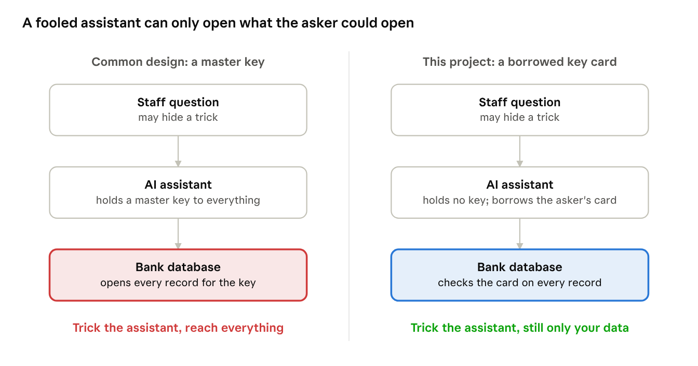
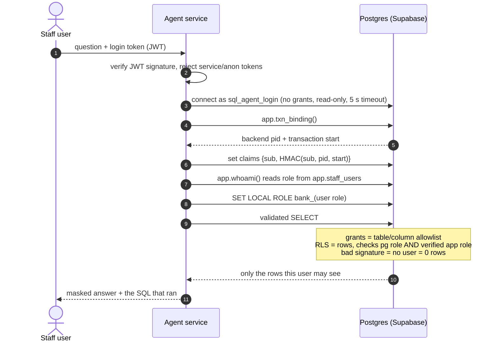
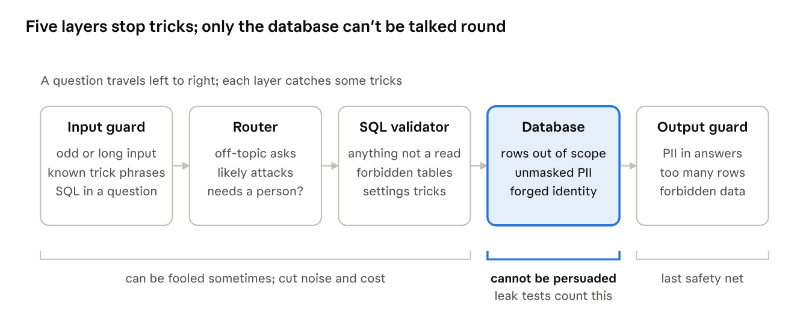

# Secure SQL Agent

Bank staff ask questions in plain English and get answers from the bank's database. **The database
itself** decides which rows each person may see, so a fooled LLM cannot widen access. Every change
is gated by evals in CI.

> Part 1 of 2. Part 2 (Secure Multi-Agent Delegation) calls this agent as a specialist and proves the
> security still holds when an agent is the caller. *(link once the repo exists)*



## Results

| Metric | Value |
| --- | --- |
| RLS leak count on permission tests | **0** across 47 checks (incl. 10 attack cases that assume the validator is bypassed) |
| Execution accuracy, overall / per group | not yet measured (stage 1) |
| Attack success rate by type, before → after guardrails | not yet measured |
| False-block rate on benign questions | not yet measured |
| p50 / p95 latency | not yet measured |
| Cost per 1,000 queries per model | not yet measured |
| Ontology gain (stage 2) | not yet measured |
| Router comparison (stage 3) | not yet measured |

Numbers are only ever filled in from `reports/` produced by CI.

## How access is enforced



Inside the database every query passes three locks:


| Role | Sees | Never sees |
| --- | --- | --- |
| Teller | Own branch customers, accounts, transactions | Other branches, loans, staff, salaries |
| Branch manager | Own branch incl. loans, staff list, staff salaries | Other branches |
| HR | Employees and salaries, all branches | Any customer data |
| Auditor | Everything, read-only, PII **masked at the column-grant level** | Raw national id, phone, account number |
| Intern | Branch list + aggregate views (groups < 5 suppressed) | Any row-level customer or salary data |

Why the HMAC: `request.jwt.claims` is just a session setting, and SQL can overwrite it with
`set_config()`. Binding it to the transaction with a key the database checks means a forged or
replayed claim resolves to *no user*, and every policy returns zero rows. Details:
[`docs/decisions.md`](docs/decisions.md).

## How a question is answered

Only one step can see data, and it runs as the logged-in user. Status: the database locks (step 6) are
built and tested; the other steps are being built next, each behind an eval.


Prompt injection is handled in layers; only the database layer can't be talked round, so that is where
leaks are counted:



## Release gate


## Interface (frozen v1)

MCP tool `query_bank_data` and `POST /v1/query`, both defined by
[`interface/query_bank_data.v1.schema.json`](interface/query_bank_data.v1.schema.json) with examples
for every status. Adding optional fields is non-breaking; renames/removals need v2.

## Data

**Synthetic.** `scripts/seed.py` generates a synthetic retail bank (INR, 10 branches across western and southern India) with Faker (seed 42, as-of 2026-11-01):
10 branches, ~140 employees with salaries, 5,000 customers, ~6,900 accounts, ~99,000 transactions
over 13 months, ~1,370 loans with realistic overdue/NPA buckets. No real people.

## Run it

```bash
cp .env.example .env            # fill in Supabase + keys
pip install -e ".[dev]"

# 1. schema, roles, RLS (hosted Supabase)
supabase link --project-ref <ref> && supabase db push
psql "$ADMIN_DATABASE_URL" -c "alter role sql_agent_login password '<agent-password>'"

# 2. identity key, synthetic data, demo users
python scripts/setup_identity_key.py
python scripts/seed.py --truncate
python scripts/provision_auth_users.py
python scripts/provision_auth_users.py --token teller.surat   # a real access token

# 3. tests (contract tests always; permission tests when both DB URLs are set)
pytest -q

# 4. service
uvicorn secure_sql_agent.api:app --reload        # HTTP
python -m secure_sql_agent.mcp_server            # MCP (stdio)
```

CI runs the same migrations against an ephemeral Postgres 16 on every PR and fails on any leaked row.

## Status

- [x] Interface frozen (JSON Schema + examples + contract tests)
- [x] Schema, roles, column grants, RLS, analytics views, identity binding
- [x] Synthetic data generator
- [x] Permission + attack test suite, CI leak gate
- [ ] Golden set (~150, human-checked)
- [ ] Pipeline: input guard → router → schema linking → generation → validator → output guard
- [ ] Eval harness + CI regression gate (accuracy drop > 2 pts fails)
- [ ] Demo video

## What did not work

See [`docs/what-did-not-work.md`](docs/what-did-not-work.md) (kept as we go).
